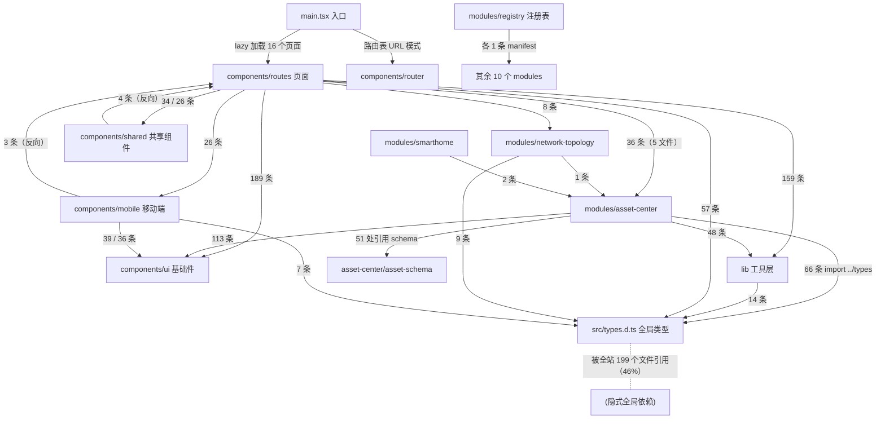

# 模块调用关系报告（Day 2）

- 生成日期：2026-10-11
- 输入：`docs/d01-overview.md`（Day 1 基线报告）
- 生成方式：全量只读扫描。Go 侧用 `go list -e`（生产代码 imports，`-e` 跳过 `internal/site` 的 dist 缺失报错）+ `grep` 交叉验证；前端用临时 Node 脚本解析 `internal/site/src` 全部 428 个 ts/tsx 的 `from`/动态 `import()`（含 `@/` 别名与 TS 扩展名补全 `.ts/.tsx/.d.ts`）。关键函数名与行号均实读源码确认。
- Day 1 核心五模块：① `internal/hub`（含 systems/ws/transport/config/utils 子包）② `agent/` ③ `internal/site/src`（资产中心）④ `internal/migrations` ⑤ `hub/ws + hub/systems + internal/records`（Agent↔Hub 通信与指标落库线）。
- 工作区口径：本次扫描基于当前工作区（git 显示仅 1 个未跟踪文件 `internal/hub/asset_parameter_agent.go`，Day 1 提到的约 60 个脏文件已清理）。

---

## 1. 核心模块依赖图

### 1.1 Go 侧：五核心模块及其邻域（边标注关键调用函数）

```mermaid
graph TD
    CMDH["cmd/hub 入口"] -->|"NewHub() / StartHub()"| HUB["internal/hub（巨包 133 文件）"]
    CMDH -.->|"blank import 迁移链"| MIG["internal/migrations"]
    CMDA["cmd/agent 入口"] -->|"NewAgent() / Start()"| AGT["agent/（采集端）"]
    CMDA -->|"health 子命令"| AHC["agent/health"]
    AGT -->|"采集产出 CombinedData"| ENT["entities/system 共享契约"]
    AGT -->|"系统指标 gopsutil"| CMN["internal/common（WS 消息+脱敏）"]
    AGT -->|""| ROOT["pulse 根包（版本常量）"]

    HUB -->|"NewAlertManager() / SendAlert()"| ALR["internal/alerts"]
    HUB -->|"NewRecordManager() / SetSystemProcessingFilter()"| REC["internal/records"]
    HUB -->|"NewSystemManager() / AddWebSocketSystem()"| SYS["hub/systems"]
    HUB -->|"NewUserManager()"| USR["internal/users"]
    USR -.->|"TempAdminEmail 常量"| MIG
    HUB -->|"config.SyncSystems()"| CFG["hub/config"]
    HUB -->|"GetEnv()"| HUT["hub/utils"]
    HUB -->|"agent_connect 升级后持有"| WS["hub/ws（CBOR 请求响应）"]
    HUB -->|"UnmarshalResponse()"| TRA["hub/transport"]
    HUB -->|"参数注册表 JSON"| ACAT["internal/assetcatalog"]
    HUB -.->|"embed dist"| SITE["internal/site（Web UI 壳）"]

    SYS -->|"WsConn.SendRequest / GetFingerprint"| WS
    SYS -->|"fetchDataViaWebSocket()"| TRA
    SYS -->|"hubLike 接口回调 SendAlert（system_alerts.go:342）"| ALR
    SYS -->|""| EXP["hub/expirymap"]
    SYS -->|""| HUT
    TRA -->|""| WS
    WS -->|""| CMN
    ALR -->|""| CMN
    REC -->|"system_stats / container_stats"| ENT
    MIG -.->|"迁移引用字段结构"| ENT
    CFG -->|""| ENT
    ENT -->|""| ENTC["entities/container + service"]
    CMN -->|""| ENT
```

说明：实线 = 生产代码 import（每条边都在 `go list` 输出里可复现）；虚线 = 弱关联（blank import、常量复用、embed）。`agent/` 还依赖 `agent/battery`、`agent/deltatracker`、`agent/utils`、`agent/zfs` 四个叶子子包（图中省略，见附录 A）。

### 1.2 前端：组级依赖图（import 语句数作边权）



要点：前端的「模块系统」（`modules/` + registry）内部边界干净——11 个模块互相之间除 registry→manifest、各模块→`modules/types` 契约外，只有 network-topology→asset-center（1 条）、smarthome→asset-center（2 条）两处业务跨界。真正的耦合集中在 `src/types.d.ts`（199 个引用者）和 `components/routes ↔ components/shared/mobile` 的双向边上。

---

## 2. 结构性问题清单

### 2.1 循环依赖

**Go import 环：0 个。** Go 编译器在编译期强制拒绝 import 环，这条结构性风险在 Go 侧不可能存在（全量 `go list` 交叉验证通过）。

但存在两类「合法但值得警惕的环」：

1. **对象图回环（接口回指）**：`hub.NewHub()` 创建并持有 `SystemManager`/`RecordManager`/`AlertManager`/`UserManager`（`internal/hub/hub.go:47-51`），而 `hub/systems` 与 `internal/alerts` 又各自定义 `hubLike` 接口反向调用 Hub（`internal/hub/systems/system_manager.go:58` 的 `SendAlert(data alerts.AlertMessageData) error`、`internal/alerts/alerts.go:157` 的 `NewAlertManager(app hubLike)`）。这是标准的依赖倒置手法（不是 import 环），但意味着 **Hub 的任何方法都可能被 systems/alerts 在事务中途回调**——`createRecords` 里 systems 主档保存触发告警 hook（`internal/hub/systems/system.go:284` 注释明言「do this last because it triggers alerts」）就是这条回环的落点。重入路径目前靠注释约定而非类型系统保证。
2. **前端 ESM 双向边**：`components/routes ⇄ components/shared`（34 条正向 / 4 条反向）、`routes ⇄ mobile`（26/3）、`routes ⇄ systems-table`（1/1）。ESM 允许，但双向边使这三组实际上是一个连通分量，无法单独拆分或懒加载。

### 2.2 孤岛模块（无任何生产代码 import）

**Go 侧真正的零引用包：0 个。** 两个初看像孤岛、实为合法入口的：

- `agent/tools/fetchsmartctl` —— 独立 main，由 `go generate`（`Makefile:87-90`）调用，是构建期工具入口，不是死代码。
- `internal/tests` —— 只被 `internal/hub` 的 `_test.go` 引用（go list 生产 imports 不含测试），是测试基建包。

**前端孤儿候选：13 个**（无任何文件 import、非入口、非测试；其中部分可能是开发中半成品，当前工作区有未跟踪的 `internal/hub/asset_parameter_agent.go` 表明参数专项三期进行中）：

| 文件 | 备注 |
|---|---|
| `modules/asset-center/components/asset-parameter-group-fetch-dialog.tsx` | 疑似参数专项（commit `5e8b4c02` 组编辑弹窗改造）后的旧实现遗留 |
| `modules/asset-center/components/asset-detail-action-menu.tsx` | 仅被同名 `.test.ts` 引用，测试仍在跑但生产无人用 |
| `modules/asset-center/components/asset-auto-fetch-step.tsx`、`asset-connection-graph.tsx`、`asset-enrichment-report-dialog.tsx`、`asset-media-rescan-dialog.tsx`、`asset-visual-preview.ts`、`asset-list-layout.ts`、`asset-source-profile.ts` | asset-center 域内候选 |
| `components/mobile/mobile-agent-tokens.tsx`、`components/ui/collapsible.tsx`、`components/ui/input-copy.tsx`、`modules/network-topology/components/topology-connection-sheet.tsx` | 零散候选 |

处理建议：参数专项收尾后逐一核对，确认后连同对应测试一起删除（「测试还在跑」不等于「代码还活着」，`asset-detail-action-menu.test.ts` 是现成反例）。

### 2.3 上帝模块

按任务给的定量阈值（被 >10 个模块依赖，或 import >15 个模块）：**Go 侧无超标者**。最接近的两个：

| 候选 | 被依赖数 | import 数 | 结论 |
|---|---|---|---|
| `internal/entities/system` | **9 个包**（agent、alerts、common、hub、hub/config、hub/systems、hub/transport、migrations、records） | 2 | 未过阈值，但它是 Agent↔Hub 共享协议契约，9 个包全部直接依赖，改动即改协议（Day 1 §A.3 已定性） |
| `internal/hub` | 1（仅 cmd/hub） | **13 个内部包**（12 业务包 + `pulse` 版本常量根包，hub 侧 11 个文件 import 它） | 未过阈值，但单包 **133 文件 / 38,658 行**，按体积是事实巨包 |

**前端有一个铁板钉钉的上帝文件**：`internal/site/src/types.d.ts` —— 78 个导出接口/类型，被 **199 / 428 个文件（46%）** 引用（其中 asset-center 22 个生产文件 + 19 个测试文件以 `import "../../types(.ts)"` 形式依赖）。且存在非常规用法：文件是 `.d.ts` 声明文件却被当模块显式 import（`../../types.ts` 靠 TS 后缀替换规则解析到 `types.d.ts`，如 `modules/asset-center/asset-export.ts:10`），全局 ambient 声明（`window.PULSE`）与可导出模块类型混在一个文件里。

### 2.4 入口模块

| 端 | 入口 | 引用的模块 |
|---|---|---|
| Hub | `internal/cmd/hub/hub.go:24` main | `internal/hub`（NewHub/StartHub）、`internal/migrations`（blank import 注册迁移链）、`pulse` 根包（版本） |
| Agent | `internal/cmd/agent/agent.go:174` main | `agent`（NewAgent）、`agent/health`、`pulse` 根包 |
| 构建期 | `agent/tools/fetchsmartctl/main.go` | 无内部依赖（go generate 下载 smartctl.exe） |
| Web | `internal/site/src/main.tsx`（366 行） | 16 个 lazy 页面（components/routes + modules/asset-center + modules/smarthome）、`components/router` |
| 桌面 | `windows/agent-config/main.go` | **独立 go.mod，不在主 module 依赖图内**（`go list ./...` 覆盖不到，测试盲区，Day 1 已标记） |

### 2.5 叶子模块（不依赖其他业务模块）

- Go：`internal/entities/{container,service,smart}`、`internal/hub/utils`（13 行 GetEnv）、`internal/hub/expirymap`、`agent/{battery,deltatracker,utils,zfs}`、`internal/assetcatalog`、`internal/site`（embed 壳）、`pulse` 根包（仅版本常量，依赖 semver 第三方）。
- 前端：`lib/enums`、`lib/utils`（cn 等）、`locales/*`、`modules/types`（契约类型）。

这些是天然的「零 mock 可测」层，也是重构时最安全的落点。

---

## 3. 核心业务数据流

选定链路：**Agent 指标采集 → WebSocket 上报 → Hub 落库 → 告警/前端消费**（Pulse 的心跳链路，注意这是「拉模型」——Hub 定时向 Agent 要数据，不是 Agent 推送）。

1. **Agent 启动连接**：`internal/cmd/agent/agent.go:174` main() 解析 `--url/--token/--code` → `agent.NewAgent()` 装配全部采集管理器 → `WebSocketClient.Connect()`（`agent/client.go:168`）带 `X-Token` 头连接 `http://<hub>:8090/api/pulse/agent-connect`。
2. **Hub 接入鉴权**：`internal/hub/agent_connect.go:35` `handleAgentConnect` → 按 token 查 `fingerprints` 集合（本机 token 仅允许回环来源）→ `X-Pulse` 版本 semver 校验（≥ `pulse.MinVersionCbor` 0.12.0）→ gws 升级为 WebSocket。
3. **指纹握手与建档**：Hub 异步 `GetFingerprint`（`internal/hub/ws/handlers.go:48`，走 RequestManager 发 `CheckFingerprint` 请求）→ Agent 的 `handleAuthChallenge` 响应 → `findOrCreateSystemForToken` 绑定或创建 `systems` 记录。
4. **注册进轮询池**：`SystemManager.AddWebSocketSystem`（`internal/hub/systems/system_manager.go:330`）→ `AddSystem` → `go sys.StartUpdater()`（`system.go:64`；首连加随机 jitter 防惊群，`system_manager.go:97` 再按系统数错峰）。
5. **周期拉取**：ticker 每 **60 秒**（`system_manager.go:30` `interval = 60_000`）触发 `sys.update()`（`system.go:143`）→ 组装 `common.DataRequestOptions`（含受监控服务/软件清单，`CacheTimeMs=60s` 让 Agent 端命中缓存免重采）→ `fetchDataViaWebSocket`（`system.go:578`）→ `WsConn.SendRequest`（`ws.go:176`）CBOR 编码下发。
6. **Agent 采集响应**：`agent/client.go:201` `OnMessage` → `handleHubRequest`（:260，handler registry 分派）→ 各采集器现场采集（CPU/内存/磁盘/网络/GPU/SMART/容器/服务/软件，gopsutil + 平台调用 + Docker socket）→ 组装 `entities/system.CombinedData{Info,Details,Stats,Containers,Services,Software}` → `sendResponse`（:290）CBOR 回传。
7. **Hub 解码**：`ws.go:71` `Handler.OnMessage` → `requestManager.handleResponse` 按 requestId 配对 → ResponseCh → `handleAgentRequest`（`ws.go:135`）cgor 解码 `AgentResponse` → `transport.UnmarshalResponse`（`transport.go:31`）还原 `CombinedData`（旧版 Agent 走 legacy 分支）。
8. **落库事务**：`sys.createRecords`（`system.go:219`）→ `hub.RunInTransaction` 内依次写入：① `system_stats`（type="1m"，:233）② `containers` + `container_stats`（:242-254）③ `monitored_services` / `monitored_software`（:260-268）④ `system_details`（仅首次，:279）⑤ `systems` 主档置 status=up 并合并 info（:285-297，**故意最后保存**因为它触发告警 hook）。
9. **告警联动**：主档保存触发 hook 链 → `system_alerts.go:342/585` 调 `SendAlert`（`alerts.AlertManager`，含 shoutrrr 通知渠道）+ `syncContainerAlertHistory` 等三处历史同步（`system.go:302-315`）。
10. **聚合与保留**：`RecordManager.CreateLongerRecords`（`records.go:57`，长周期聚合）与 `RunMonitorRetentionCron`（`retention.go:51`，30 天删除）异步维护指标表。
11. **前端消费**：SSE 实时订阅 `rt_metrics` 主题（`system_realtime.go`，订阅先过 `RealtimeSubscriptionModule` 模块门）+ REST `/api/pulse/systems/summary`（`systems_summary.go:81`）→ React 图表渲染。

**外部依赖盘点（这条链路）**：SQLite（PocketBase 内嵌 modernc 驱动，唯一持久层）、gws（WebSocket）、fxamacker/cbor（编解码）、gopsutil（Agent 采集）、shoutrrr（通知外发）、Docker socket（Agent 容器采集）。**没有缓存中间件、没有消息队列**——所有流量直连 SQLite，读模型一致性完全靠 PocketBase 集合规则 + 事务保证（这是 Day 1 风险 ①「规则双真源」值得重视的架构原因）。

---

## 4. 各模块耦合度评估

评分口径：1=近乎独立，5=动一发牵全身。

| 模块 | 对外暴露 | 依赖谁 | 单测需 mock | 评分 | 理由 |
|---|---|---|---|---|---|
| `internal/hub` | `Hub`、`NewHub`、`StartHub`、`MakeLink` + 各 handler（导出面窄） | 13 个内部包（含 pulse 根包）+ PocketBase 全家 | core.App（已有 `internal/tests`+TestApp 基建兜底）、5 个 manager 协同 | **4** | import 面未超阈值，但 133 文件共享一个包命名空间，私有符号全连通，隐式耦合不可见；测试基建完善是唯一减震器 |
| `agent/` | `Agent`、`NewAgent`、`Start`、采集管理器系列 | 11 个内部包（含 pulse 根包；10 个为叶子实体/工具包）+ gopsutil/Docker/NVML/LHM/smartctl | 平台环境（build tag 隔离 + `test-data` 已备），外部二进制依赖无法全 mock | **4** | 「运行在别人机器上」的最脆弱端；好在依赖的多是纯数据叶子包 |
| `internal/site/src`（asset-center） | 组件 + 纯函数（`asset-schema` 被 51 处引用，47 处在模块内） | `types.d.ts`（22 个文件）、`components/ui`、`lib`、pocketbase SDK | 纯函数测试 node 直跑、mock≈0；组件测试缺框架 | **3** | 模块内聚好、跨界仅 4 处；扣分项是全局类型文件依赖和「无断言框架」的测试形态 |
| `internal/migrations` | 迁移链（blank import 注册）+ `TempAdminEmail` 常量 | `entities/system` | TestApp 跑迁移即测 | **2** | 近乎纯声明层；唯一问题是与 `collections.go` 构成规则双真源（见建议 3） |
| `hub/ws` | `WsConn`、`GetUpgrader`、`SendRequest`、`GetFingerprint` | `common` + cbor + gws | 一个假 gws.Conn（已有 `ws_test_helpers.go`） | **2** | 全项目最干净的传输层，职责单一 |
| `hub/systems` | `SystemManager`、`System`、`Add*/Fetch*` 系列 | 10 个包 + `hubLike` 回调接口 | TestApp + 假 WS + 假时钟（synctest 已用）；hook 链带 alerts 连带 | **5** | 全项目耦合最重：上游握着 ws/transport，下游直连 SQLite 事务、SSE 分发、告警回环、记录保留，一处改动四个域感知 |
| `internal/records` | `RecordManager`、`CreateLongerRecords`、`AverageSystemStats*` | `core.App` + dbx + entities | TestApp | **3** | 依赖面窄，但 `SetSystemProcessingFilter`（`hub.go:50`）把 Hub 的过滤策略注入进来，行为由外部配置 |

---

## 5. 重构建议（3 条）

### 建议 1：按文件名前缀分簇，先拆 `internal/hub` 里独立性最强的资产媒体/富化两族

- **现在的问题**：`internal/hub` 单包 133 文件 / 38,658 行（Day 1 §1 规模数据），资产域五族文件（media×10、enrichment×12、visuals×5、migration×3、validation×4）与 Agent 发布、备份、运维全部共享一个 Go 包命名空间——任何文件可直调任何私有函数，跨域隐式调用无法被编译器暴露；1.4 万行测试也挤在同一包里。
- **怎么改**：第一步只做「簇清点」不改代码——按 `asset_media*`、`asset_enrichment*` 等前缀画出簇内互调关系（可用 `go vet`+grep 完成）；第二步把互调最封闭的 `asset_media` 族拆为 `internal/hub/assetmedia` 子包，对外只暴露一个 `RegisterRoutes(e)` + `BindHooks(app)`（项目在 `hub.go:52-62` 已有 12 个 `bindXxxHooks` 的现成模式可套）；路由注册表 `api.go` 不动，只挪实现。
- **好处**：资产媒体族的私有符号立刻获得编译期封装；测试文件随之归组；后续拆 enrich/visuals 有模板可循；Hub 巨包风险面从「任意文件互调」收窄为「显式导出面」。
- **风险**：簇间若有私有符号互用需提升导出或下沉共享小包；Go 禁止 import 环，必须先画完簇再动刀（顺序错了会产生环又得合回去）；一次性全拆风险大，务必一族一族来。

### 建议 2：拆掉前端上帝文件 `src/types.d.ts`

- **现在的问题**：`internal/site/src/types.d.ts` 78 个导出被 199/428 个文件（46%）引用，asset-center 有 22 个生产文件显式 `import "../../types(.ts)"`（如 `modules/asset-center/asset-auto-fetch.ts:2`、`asset-export.ts:10`）；`.d.ts` 声明文件被当模块 import 属于非常规用法（依赖 TS 把 `types.ts` 后缀替换解析到 `types.d.ts` 的规则）；modules/* 反向依赖 src 根，与正在建设的「基础底座+模块」边界方向相反。
- **怎么改**：按域拆到 `modules/<x>/types.ts`（SystemRecord 等客户端监控类型 → client-monitoring、AssetRecord 等 → asset-center）与 `lib/types/`（跨域枚举）；import 路径统一改用已配置但几乎无人用的 `@/` 别名（`tsconfig.app.json` paths，目前仅 `types.d.ts:2` 用过一次）；`types.d.ts` 只保留 `window.PULSE` 等 ambient 全局声明。分批进行：先迁 asset-center 的 22 处，typecheck 过一批再下一批。
- **好处**：模块自治（模块目录可整体搬移，懒加载与模块门禁边界更干净）；类型责任归属明确；消除 `.d.ts` 被显式 import 的歧义用法；199 处引用的隐形全局依赖变成显式域内依赖。
- **风险**：改动文件量大（199 处 import），必须靠 `npm run typecheck` 做机械门禁分批推进；`types.d.ts` 里全局声明与导出混杂，拆分时若漏迁 `window.PULSE` 声明会导致运行时类型丢失（编译不报错、只在用到 PULSE 的地方才炸）。

### 建议 3：收敛集合规则「双真源」与 `SHARE_ALL_SYSTEMS` 四处判断

- **现在的问题**：同一集合的 API 规则存在两处定义——迁移 JSON 内嵌旧规则（`internal/migrations/assets_collections.go:13-17` 的 userMatches 规则）与启动时统一覆盖（`internal/hub/collections.go:114-122` 的家庭共享规则）；且 `SHARE_ALL_SYSTEMS` 的环境变量判断散布 4 个文件（`collections.go:56-73`、`dashboard_summary.go:114`、`important_monitoring.go:294`、`systems/system.go:514`）。Day 1 已将其列为风险 ①（历史上发生过 PBL-023 读模型缺口）。
- **怎么改**：① 不改历史迁移（迁移不可变），新增一个迁移把旧集合 JSON 里的规则字段置为空白/托管标记，并在 `collections.go` 顶部注释声明「规则唯一真源在此」；② 把 4 处 env 判断收敛为一个共享函数（放进 `hub/utils`，与 `GetEnv` 同居），四处调用点改为调函数。
- **好处**：规则漂移面从 2 处降为 1 处；`SHARE_ALL_SYSTEMS` 语义单点可测（现在想测「4 处判断一致」只能人肉比对）；这是 Day 1 风险清单里成本最低、收益直接的一条。
- **风险**：新迁移在全量旧库上的执行需要用 `pulse_data` 本地库预演（规则清空后到启动覆盖之间有一个窗口，需确认 PocketBase 加载顺序上迁移先于 `initialize`——`hub.go:63` 的 `onAfterBootstrapAndMigrations` 已保证此顺序，风险可控）；函数收敛是行为等价重构，以现有 collections 测试兜底。

---

## 附录 A：全项目模块依赖矩阵

### A.1 Go 包（module `gutenacht.site/pulse`，21 包，生产代码口径）

| 包 | 依赖（import 了谁） | 被谁依赖（反向） |
|---|---|---|
| `pulse`（根，版本常量） | —（仅第三方 semver） | agent、internal/cmd/agent、internal/cmd/hub、internal/hub（4 包；agent 侧 8 文件、hub 侧 11 文件） |
| `internal/cmd/hub` | internal/hub、internal/migrations | —（main 入口） |
| `internal/cmd/agent` | agent、agent/health | —（main 入口） |
| `internal/hub` | pulse（根包）、alerts、assetcatalog、common、entities/system、hub/config、hub/systems、hub/transport、hub/utils、hub/ws、records、site、users（13） | internal/cmd/hub |
| `internal/hub/systems` | alerts、common、entities/{container,service,smart,system}、hub/expirymap、hub/transport、hub/utils、hub/ws（10） | internal/hub |
| `internal/hub/ws` | common | internal/hub、hub/systems、hub/transport |
| `internal/hub/transport` | common、entities/{smart,system}、hub/ws | internal/hub、hub/systems |
| `internal/hub/config` | entities/system | internal/hub |
| `internal/hub/utils` | — | internal/hub、hub/systems |
| `internal/hub/expirymap` | — | hub/systems |
| `internal/alerts` | common、entities/system | internal/hub、hub/systems |
| `internal/records` | entities/{container,system} | internal/hub |
| `internal/users` | internal/migrations | internal/hub |
| `internal/common` | entities/{service,smart,system} | agent、internal/alerts、internal/hub、hub/systems、hub/transport、hub/ws（6） |
| `internal/entities/system` | entities/{container,service} | agent、alerts、common、hub、hub/config、hub/systems、hub/transport、migrations、records（**9，全项目最高**） |
| `internal/entities/container` | — | agent、entities/system、hub/systems、records |
| `internal/entities/service` | — | agent、common、entities/system、hub/systems |
| `internal/entities/smart` | — | agent、common、hub/systems、hub/transport |
| `internal/migrations` | entities/system | internal/cmd/hub（blank）、internal/users |
| `internal/assetcatalog` | —（仅 JSON 资源） | internal/hub |
| `internal/site` | —（embed dist） | internal/hub |
| `agent` | pulse（根包）、agent/{battery,deltatracker,health,utils,zfs}、internal/common、entities/{container,service,smart,system}（11） | internal/cmd/agent |
| `agent/battery`、`agent/deltatracker`、`agent/utils`、`agent/zfs` | — | agent |
| `agent/health` | — | agent、internal/cmd/agent |
| `agent/tools/fetchsmartctl` | — | —（go generate 构建期入口） |
| `internal/tests` | — | internal/hub（仅测试文件） |

> 未计入：`windows/agent-config`（独立 go.mod 的 Wails 工程，不参与主 module 构建，是测试盲区）；`agent/lhm`（C# 工程，无 Go 文件）。

### A.2 前端组级矩阵（`internal/site/src`，428 个 ts/tsx，含 `@/` 别名与动态 import）

被依赖次数 = 被多少条 import 语句指向（组内互引不计）：

| 组 | 被谁依赖（次数） | 合计入度 |
|---|---|---|
| `types.d.ts`（src 根全局类型） | routes(57)、asset-center(66+19 测试)、lib(14)、network-topology(9+5)、mobile(7)、charts(4)、shared(5)、login(1)、containers-table(2)、systems-table(2)、alerts(2)、ui(1)、smarthome(1)、website-monitoring(1)、src 根杂项等 | **199 个文件** |
| `components/ui` | routes(189)、asset-center(113)、mobile(39)、shared(34)、routes 测试、containers-table(14)、charts(3)、systems-table(10)、monitored-services-table(10)、alerts(8)、login(6)、lib(5)、network-topology(7)、smarthome(6)、module-state(1)、src 根(1) 等 | 最高的代码组 |
| `lib` | routes(159)、asset-center(48)、mobile(36)、shared(27)、ui(26)、charts(8)、login(7)、network-topology(4)、systems-table(14)、containers-table(14) 等 | 次高 |
| `components/routes` | main.tsx（16 个页面 lazy）、shared(4 反向)、systems-table(1 反向)、mobile(3 反向) | 入口层 |
| `components/shared` | routes(34)、mobile(15)、asset-center(6)、systems-table(5)、charts(3)、containers-table(1)、login(1)、src 根(4) | |
| `components/mobile` | routes(26)、shared(2)、containers-table(1) | |
| `components/charts` | routes(16) | |
| `components/{systems-table, containers-table, monitored-services-table, alerts, login}` | routes 各 1-2 条 | 单一消费者 |
| `modules/registry.ts` | module-state、routes(2)、src 根、2 个自身测试 | 注册中心 |
| `modules/types.ts` | 11 个模块 manifest + module-state + routes(3) + shared(1) + mobile(1) | 契约类型 |
| `modules/asset-center` | main.tsx（detail/edit 页 lazy）、routes(36)、network-topology(1)、smarthome(2)、shared(1)、src 根(1) | 模块间最高 |
| `modules/{smarthome}` | main.tsx（page lazy）、src 根(1) | |
| `modules/{network-topology}` | routes(8) | |
| `modules/{maintenance, website-monitoring, account-access, agent-management, alerts, client-monitoring, notifications, foundation}` | routes 或 registry 各 1-2 条 | 边界最干净的一组 |
| `locales` | lib(1) | i18n 由构建期编译注入 |

模块间业务跨界（排除 registry→manifest 与 →types 契约）：`network-topology → asset-center` 1 条（fixed-topology-canvas.tsx）、`smarthome → asset-center` 2 条（page.tsx）、`routes → asset-center` 36 条（5 文件，其中 add-system.tsx 与 assets.tsx 引 asset-schema）。前端「模块系统」总体内聚良好，最大债在 types.d.ts 与 routes↔shared/mobile 双向边。

---

*报告完。给 Day 3 的输入：① 建议按本报告 §5 顺序处理（建议 3 成本最低可先行）；② 13 个前端孤儿候选待参数专项收尾后核对清理；③ `hub/systems` 的 5 分耦合是后续任何监控链路改动前的必读地图（§3 数据流）。*
